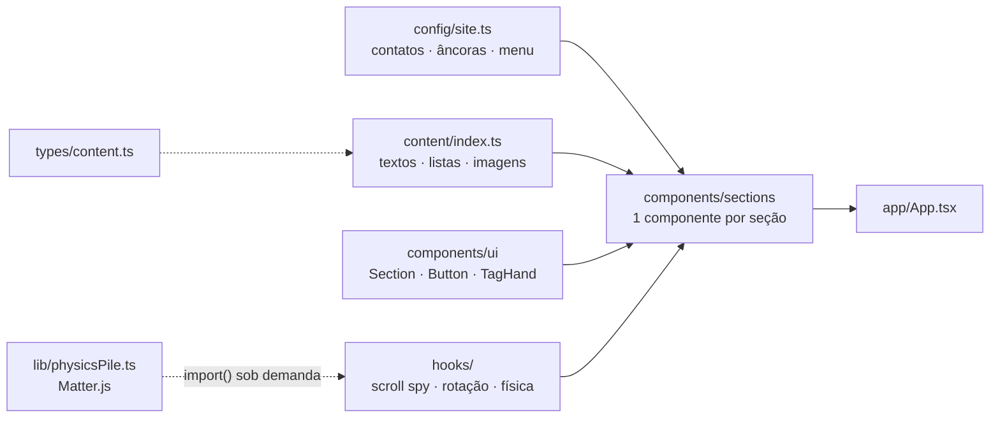
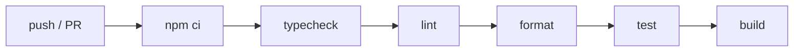

<div align="center">


<br />

[](https://github.com/Matheusvc/portfolio/actions/workflows/ci.yml)


**SPA em React + TypeScript, com animações físicas e arquitetura orientada a conteúdo.**<br />
Sem back-end, sem CMS: build estático, pronto para qualquer CDN.

[Arquitetura](#-arquitetura) · [Performance](#-performance) · [Qualidade](#-qualidade) · [Rodando localmente](#-rodando-localmente)

</div>

---

## ✨ Destaques

|     |                              |                                                                                         |
| :-: | ---------------------------- | --------------------------------------------------------------------------------------- |
| 🧲  | **Física em tempo real**     | Etiquetas caem e se empilham com Matter.js, arrastáveis com o mouse                     |
| 💻  | **Carrossel 3D de projetos** | Telas giram entre notebook e cards via refs + CSS transitions, sem re-render por quadro |
| ⚡  | **Code splitting**           | O motor de física só é baixado quando a seção se aproxima da tela                       |
| 🖼️  | **Imagens otimizadas**       | WebP no dobro do tamanho de exibição: de 3,8 MB para 650 KB                             |
| ♿  | **Acessível por padrão**     | ARIA, foco visível, `Esc` no menu e respeito a `prefers-reduced-motion`                 |
| 🧪  | **Testado e com CI**         | Vitest + Testing Library e pipeline no GitHub Actions a cada push                       |

## 🧰 Stack

<p align="center">
  
</p>

| Camada    | Tecnologia                                                   |
| --------- | ------------------------------------------------------------ |
| UI        | React 18 · TypeScript 5 (`strict`)                           |
| Estilo    | Tailwind CSS 3 com design tokens · PostCSS                   |
| Build     | Vite 5 · `import()` dinâmico para code splitting             |
| Animação  | CSS transitions/keyframes · Matter.js (física 2D)            |
| Testes    | Vitest · Testing Library · jsdom                             |
| Qualidade | ESLint 9 (`typescript-eslint` strict, `jsx-a11y`) · Prettier |
| CI        | GitHub Actions                                               |

## 🏗️ Arquitetura



- **Conteúdo desacoplado da UI:** componentes só renderizam o que vem de `content/` e `config/`. Trocar texto, link ou imagem não toca em JSX.
- **Comportamento em hooks:** scroll spy, carrossel, hover, visibilidade da aba e movimento reduzido são hooks isolados e reutilizáveis.
- **React onde ajuda, DOM onde é mais rápido:** animações contínuas rodam por refs e CSS, e o estado do React guarda só o que a interface precisa saber.
- **Tema por seção:** `<Section tone="blue | white | navy">` centraliza a sequência de cores da página.

<details>
<summary><b>📁 Estrutura de pastas</b></summary>

```
front-end/src/
├── app/            # composição da página
├── components/
│   ├── layout/     # Navbar, Footer
│   ├── sections/   # Hero, Projetos, Serviços, FAQ…
│   └── ui/         # primitivos visuais
├── config/         # dados do site (contato, rotas)
├── content/        # conteúdo tipado
├── hooks/          # lógica de UI
├── lib/            # código sem React, carregado sob demanda
├── styles/         # Tailwind + CSS puro (pseudo-elementos, keyframes)
├── types/          # contratos de dados
└── test/           # setup do Vitest
```

</details>

## ⚡ Performance

| Métrica                | Valor                                                    |
| ---------------------- | -------------------------------------------------------- |
| JS inicial             | **59 KB** gzip                                           |
| Física (Matter.js)     | chunk de **27 KB**, baixado perto da seção               |
| Imagens                | **650 KB** em WebP (antes: 3,8 MB)                       |
| Animações fora da tela | pausadas via `IntersectionObserver` e `visibilitychange` |

## 🧪 Qualidade



Testes ao lado do código (`*.test.tsx`), focados no que o visitante faz: abrir e fechar o menu, navegar pelo FAQ, trocar o projeto em destaque. Também garantem que nenhum link interno aponta para o vazio, que links externos usam `rel="noopener"`, que toda imagem tem `alt` e que o link do WhatsApp está correto.

## 🚀 Rodando localmente

> Requer **Node 20+** (versão de referência em `front-end/.nvmrc`).

```bash
git clone https://github.com/Matheusvc/portfolio.git
cd portfolio/front-end
npm install
npm run dev
```

<details>
<summary><b>📜 Scripts disponíveis</b></summary>

| Script            | O que faz                                       |
| ----------------- | ----------------------------------------------- |
| `npm run dev`     | servidor de desenvolvimento em `:4567`          |
| `npm run build`   | typecheck + build de produção em `dist/`        |
| `npm run preview` | serve o build localmente                        |
| `npm run test`    | testes (`test:watch` para modo contínuo)        |
| `npm run check`   | tipos + lint + formatação + testes (igual à CI) |
| `npm run format`  | formata o código com Prettier                   |

</details>

## 🗺️ Roadmap

- [x] Migração de HTML/CSS/JS para React + TypeScript + Tailwind
- [x] Testes automatizados e CI
- [x] Imagens em WebP e code splitting
- [ ] Deploy contínuo
- [ ] `back-end/` caso o site ganhe formulário, painel ou CMS

## 📫 Contato

<p>
  <a href="https://www.linkedin.com/in/matheusslira/"></a>
  <a href="https://github.com/Matheusvc"></a>
  <a href="mailto:matheusvitorcl1@gmail.com"></a>
  <a href="https://wa.me/5598987577739"></a>
</p>
