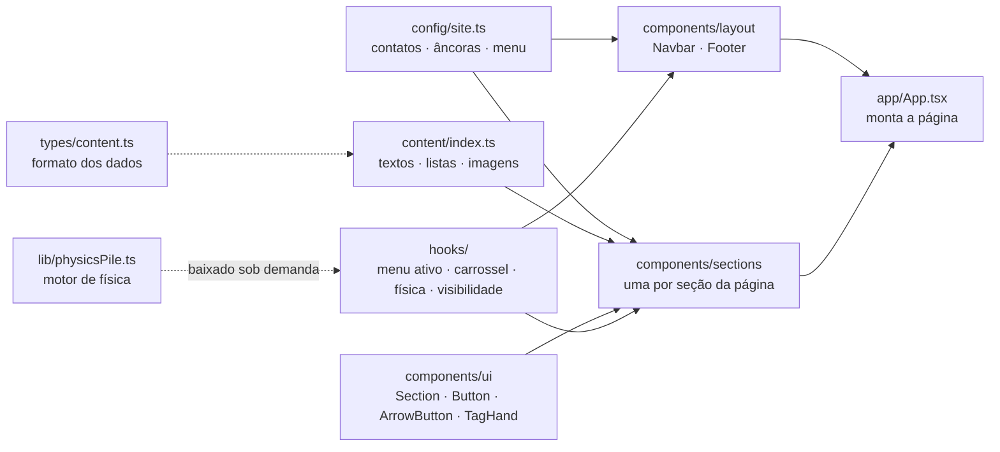
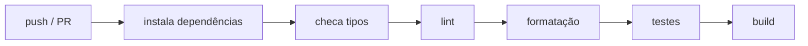

<div align="center">



<br />

[](https://github.com/Matheusvc/portfolio/actions/workflows/ci.yml)


**Portfólio pessoal em React + TypeScript, com animações físicas e conteúdo separado do código.**<br />
Site estático: não tem back-end nem banco de dados, e o contato vai direto para o WhatsApp.

[Destaques](#-destaques) · [Arquitetura](#-arquitetura) · [Performance](#-performance) · [Qualidade](#-qualidade) · [Rodando localmente](#-rodando-localmente) · [Glossário](#-glossário)

</div>

---

## ✨ Destaques

|     |                              |                                                                                                                             |
| :-: | ---------------------------- | --------------------------------------------------------------------------------------------------------------------------- |
| 🧲  | **Física em tempo real**     | As etiquetas da seção “Tudo que seu projeto precisa” caem e se empilham com Matter.js; dá para arrastá-las com o mouse      |
| 💻  | **Carrossel por projeto**    | Telas reais agrupadas por projeto: o notebook mostra a principal e os cards, as demais; ao trocar, a tela “liga” com efeito |
| ⚡  | **Carregamento sob demanda** | O motor de física só é baixado quando o visitante chega perto da seção que o usa                                            |
| 🖼️  | **Imagens leves**            | WebP no dobro do tamanho em que aparecem: de 3,8 MB para 630 KB                                                             |
| ♿  | **Acessível**                | Navegação por teclado, leitores de tela e respeito a quem prefere menos movimento                                           |
| 🧪  | **Testado a cada push**      | 13 testes automáticos e verificação completa no GitHub Actions                                                              |

## 🧰 Stack

<p align="center">
  
</p>

| Camada    | Tecnologia                                | Para que serve                                         |
| --------- | ----------------------------------------- | ------------------------------------------------------ |
| Interface | React 18 · TypeScript 5 (modo `strict`)   | componentes da página, com tipos checados              |
| Estilo    | Tailwind CSS 3 · PostCSS · Autoprefixer   | cores, fontes e espaçamentos padronizados              |
| Build     | Vite 5                                    | servidor de desenvolvimento e versão final otimizada   |
| Animação  | CSS (transitions e keyframes) · Matter.js | carrossel, faixa de ferramentas e etiquetas com física |
| Testes    | Vitest · Testing Library · jsdom          | simula o navegador e testa o que o visitante faz       |
| Qualidade | ESLint 9 · Prettier                       | encontra erros e padroniza a formatação                |
| CI        | GitHub Actions                            | roda todas as verificações a cada envio de código      |

## 🏗️ Arquitetura



<sub>A seta indica “é usado por”. Linha tracejada: dependência só de tipo ou carregada depois.</sub>

**Quatro decisões guiam o projeto:**

1. **Conteúdo separado do código.** Todo texto, link e imagem fica em `content/` e `config/`. Os componentes só exibem esses dados, então atualizar o portfólio não exige mexer na interface.
2. **Comportamentos isolados em hooks.** Cada efeito da página (destacar o item do menu, girar o carrossel, pausar fora da tela, respeitar movimento reduzido) é uma função própria, reutilizável e testável.
3. **Animação fora do React quando é contínua.** O carrossel e a física movem os elementos direto no DOM; o React só guarda o que muda a interface (por exemplo, qual projeto está em destaque). Isso evita redesenhar a página a cada quadro.
4. **Cores por seção centralizadas.** `<Section tone="blue | white | navy">` define o fundo de cada seção e mantém a sequência azul → branco → marinho → branco.

<details>
<summary><b>📁 Estrutura de pastas</b></summary>

```
front-end/src/
├── app/            # monta a página na ordem das seções
├── components/
│   ├── layout/     # Navbar e Footer
│   ├── sections/   # Hero, Projetos, Serviços, FAQ…
│   └── ui/         # peças visuais reutilizáveis
├── config/         # contatos, âncoras e menu
├── content/        # textos, listas e imagens
├── hooks/          # comportamentos da interface
├── lib/            # motor de física (sem React)
├── styles/         # Tailwind + CSS que precisa ser escrito à mão
├── types/          # formato de cada tipo de conteúdo
├── assets/images/  # imagens em WebP
└── test/           # configuração dos testes
```

</details>

## ⚡ Performance

| O que              | Resultado                                                            |
| ------------------ | -------------------------------------------------------------------- |
| JavaScript inicial | **59 KB** comprimido (gzip)                                          |
| CSS                | **9 KB** comprimido                                                  |
| Motor de física    | **27 KB** à parte, baixado quando a seção está a ~800 px de aparecer |
| Imagens            | **630 KB** em WebP (antes: 3,8 MB em PNG e JPG)                      |
| Carrossel          | pausa fora da tela, com a aba em segundo plano e com o mouse em cima |
| Física             | para de calcular quando a seção sai da tela                          |

## 🧪 Qualidade

A cada envio de código (push) ou pull request, o GitHub Actions executa:



Se qualquer etapa falhar, o selo **CI** no topo fica vermelho.

Os 13 testes, em 5 arquivos ao lado do código (`*.test.tsx`), verificam:

- o menu abre, fecha com `Esc`, fecha ao clicar fora e devolve o foco ao botão;
- o FAQ mantém só uma resposta aberta por vez;
- cada projeto mostra todas as suas telas, com texto alternativo, e troca ao clicar no botão;
- nenhum link interno aponta para uma seção que não existe;
- links externos abrem em nova aba com `rel="noopener"`;
- toda imagem tem texto alternativo (`alt`);
- o link do WhatsApp tem o número e a mensagem certos.

**Acessibilidade:** link para pular direto ao conteúdo, um único título principal (`h1`), menu e FAQ com atributos ARIA, foco visível no teclado e animações desligadas para quem ativa “reduzir movimento” no sistema. O ESLint com `jsx-a11y` barra erros de acessibilidade antes do build.

## 🚀 Rodando localmente

> Requer **Node 20 ou mais novo** (versão de referência no `.nvmrc`, a mesma usada pela CI).

```bash
git clone https://github.com/Matheusvc/portfolio.git
cd portfolio/front-end
npm install
npm run dev
```

O site abre em `http://localhost:4567`.

<details>
<summary><b>📜 Scripts disponíveis</b></summary>

| Script            | O que faz                                             |
| ----------------- | ----------------------------------------------------- |
| `npm run dev`     | servidor de desenvolvimento com recarga automática    |
| `npm run build`   | checa tipos e gera a versão final em `dist/`          |
| `npm run preview` | abre localmente a versão final gerada                 |
| `npm run test`    | roda os testes (`test:watch` repete a cada alteração) |
| `npm run check`   | tipos + lint + formatação + testes, igual à CI        |
| `npm run format`  | formata todo o código com o Prettier                  |

</details>

## 📖 Glossário

<details>
<summary><b>Os termos técnicos deste README, em uma linha cada</b></summary>

| Termo                        | Significado                                                                                       |
| ---------------------------- | ------------------------------------------------------------------------------------------------- |
| **SPA / site estático**      | o site é um conjunto de arquivos prontos (HTML, CSS, JS); não depende de servidor próprio         |
| **TypeScript `strict`**      | JavaScript com tipos; o modo estrito recusa código com tipos ambíguos                             |
| **Build**                    | processo que junta e comprime o código na versão final que vai para o ar                          |
| **gzip**                     | compressão usada na transferência; é o tamanho que o visitante realmente baixa                    |
| **Carregamento sob demanda** | parte do código fica num arquivo separado e só é baixada quando for necessária (_code splitting_) |
| **Hook**                     | função do React que guarda um comportamento reutilizável (ex.: saber se a aba está visível)       |
| **DOM**                      | a estrutura da página no navegador; mexer nele direto é mais rápido para animações                |
| **WebP**                     | formato de imagem mais leve que PNG e JPG, com a mesma qualidade visual                           |
| **Lint (ESLint)**            | ferramenta que aponta erros e más práticas no código antes de rodar                               |
| **Prettier**                 | formatador automático; deixa todo o código com o mesmo estilo                                     |
| **CI (GitHub Actions)**      | robô que testa e compila o projeto a cada envio de código                                         |
| **ARIA**                     | atributos que descrevem a interface para leitores de tela                                         |
| **jsdom**                    | navegador simulado usado pelos testes                                                             |

</details>

## 🗺️ Roadmap

- [x] Migração de HTML/CSS/JS para React + TypeScript + Tailwind
- [x] Testes automatizados e CI
- [x] Imagens em WebP e carregamento sob demanda
- [ ] Publicação automática do site (deploy contínuo)
- [ ] `back-end/` ao lado do `front-end/`, se o site ganhar formulário, painel ou CMS

## 📫 Contato

<p>
  <a href="https://www.linkedin.com/in/matheusslira/"></a>
  <a href="https://github.com/Matheusvc"></a>
  <a href="mailto:matheusvitorcl1@gmail.com"></a>
  <a href="https://wa.me/5598987577739"></a>
</p>
